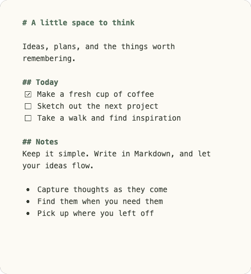
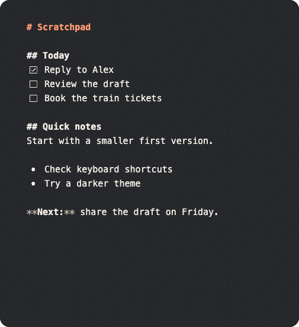

# Bulletnotes

A small desktop notebook for [SilverBullet](https://silverbullet.md/). Capture thoughts in Markdown, keep working offline, and sync when you’re connected.

[Explore Bulletnotes](https://leesiongchan.github.io/bulletnotes/) · [Product page development](site/README.md)

<p align="center">
  
  
</p>

## What it does

- **Capture quickly:** create scratchpads that sync to `Quick Notes/` in your SilverBullet space.
- **Work offline:** edits are saved locally and synced when a compatible server is available.
- **Find your notes:** search parts of words across pages, browse lists or cards, or find text within the current note.
- **Manage scratchpads:** select notes, reorder the stack, promote notes to the front, or move a batch to recoverable Trash.
- **Write in Markdown:** edit source with syntax highlighting, task checkboxes, and formatting shortcuts.
- **Make it yours:** choose light and dark themes, font size, and plain, dotted, ruled, or grid paper.
- **Keep your work:** conflicting edits are preserved in recovery pages; deleted notes go to Trash.

## Get started

Download a development build from [GitHub Releases](https://github.com/leesiongchan/bulletnotes/releases), or build from source below. Bulletnotes targets macOS 14+ on Apple Silicon, and Windows and Linux on x64 or ARM64. Development builds are not production releases; see the [build notes](docs/build.md) for platform requirements and installation details.

Open Bulletnotes and use **Settings** to connect to your SilverBullet server over HTTPS. You can save the token in your system credential store or use it for the current session. Notes can be captured locally before connecting.

## Shortcuts

| Action | macOS | Windows / Linux |
| --- | --- | --- |
| New scratchpad | ⌘ N | Ctrl N |
| Search pages | ⌘ K | Ctrl K |
| Find in note | ⌘ F | Ctrl F |
| Older / newer scratchpad | ⌘ [ / ⌘ ] | Ctrl [ / Ctrl ] |
| Appearance settings | ⌘ , | Ctrl , |

See the [usage guide](docs/usage.md) for editing shortcuts, sync, and recovery.

## Build from source

Install Rust 1.99.1 and the native dependencies for your platform, then run:

```sh
rustup run 1.99.1 cargo run
```

For platform prerequisites, packaging, and development checks, see the [build guide](docs/build.md). For custom palettes, see the [theme guide](docs/themes.md).
