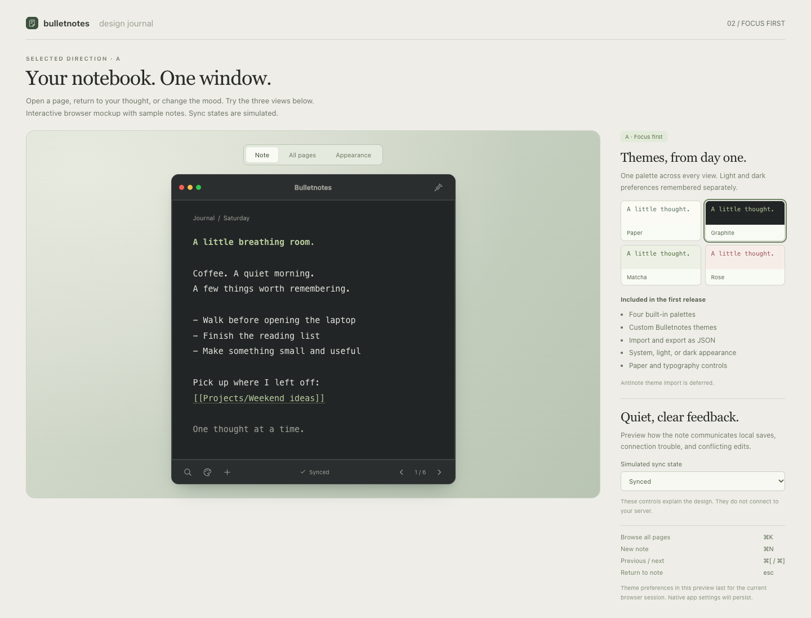

# Bulletnotes: native macOS quick notes with SilverBullet

Date: 2026-10-17

Status: UI/UX, written specification, and implementation plan approved in conversation on 2026-10-17; user selected native inline execution. After the native styling probe, the user approved revision A: keep the supported Slint plain-text editor and full theme support; defer inline heading/link colors.

## Intent and agreed decisions

Build a production-grade macOS app in Rust and Slint that provides Antinote's compact, responsive note-taking experience over the user's SilverBullet space at `https://notes.harflix.lol`.

The user selected a personal quick-note client, automatic synchronization, and access to every Markdown page in the space. The app must feel immediate while preserving notes when the network fails or the same page is edited in SilverBullet's browser client.

The approved UI is **A: focus first**. A single note fills a compact window. Page search replaces the editor within that window; opening a result returns to the note view. A permanent folder sidebar is excluded from this direction. Themes are a first-release feature. Custom themes use Bulletnotes' own format; Antinote theme import is deferred.

The user approved the updated interactive mockup with "perfect". Its visual proportions, restrained controls, paper treatment, and theme behavior are the design reference. The original request for Antinote fidelity is interpreted through that approved reference, with native editing, gestures, and window behavior still requiring validation.

## Scope

The first production release includes:

- A native Slint note window, all-page search, and Appearance settings.
- Creating notes and reading/editing all accessible Markdown pages in the configured SilverBullet space.
- Automatic local persistence and bidirectional background synchronization.
- Offline access to downloaded pages and offline creation/editing.
- Keyboard navigation, a configurable global activation shortcut, a menu-bar entry, and pin-above-other-windows behavior.
- Four built-in palettes, custom Bulletnotes theme import/export, independent light/dark preferences, paper styles, and text sizing. Native blur/translucency is deferred by user-approved revision B; the first release uses solid paper.
- Recovery and actionable feedback for conflicts, authentication problems, connection failures, and local save failures.
- macOS packaging, release verification, and documented support boundaries.

Later stages cover inline math, reactive variables, conversions, OCR, AutoPaste, timers, Antinote theme import, and utility extensions. SilverBullet's queries, Lua runtime, and plugins are outside this client's first-release scope. Their source text remains editable without executing it. Attachments and embedded images remain intact as Markdown references; attachment management and embedded media rendering are deferred.

There is no automatic expiry of existing SilverBullet pages. This app connects a scratchpad interaction model to a persistent knowledge base. Explicit page deletion requires recoverable local trash and conflict-aware remote deletion; trash is emptied only by an explicit action in this release. Renaming pages and rewriting incoming links are deferred.

## Design alternatives and selection

Two UI approaches were compared in the visual companion:

| Approach | Benefit | Cost | Decision |
| --- | --- | --- | --- |
| Compact note with a search view | Preserves the Antinote interaction and writing space | Folder context appears during browsing | Selected by user |
| Persistent folder sidebar | More navigation is always visible | Uses note space and makes the app feel like a document manager | Not selected |

For implementation, use focused custom Slint components driven by a shared theme palette. Restyling standard widgets would reduce initial UI work, but it gives less control over the approved appearance. Use documented Slint input and accessibility facilities within those custom components rather than rebuilding basic text behavior unnecessarily.

## Visual reference



The standalone [interactive design reference](assets/bulletnotes-focus-first.html) preserves the Note, All pages, and Appearance flows and theme controls. It is an HTML design artifact, not the application architecture. Its sample notes, simulated sync states, browser focus behavior, and opacity effects are demonstrations rather than evidence of native functionality.

## Window and navigation

The default content size is approximately 505 by 552 logical pixels, matching the approved preview. The window is resizable, with a 400 by 440 logical-pixel minimum. Controls remain reachable through scrolling and layout changes at the minimum size.

The note body receives most of the window. A quiet path label identifies the current SilverBullet page. The bottom bar provides search, Appearance, a new-note action, save/sync status, and previous/next navigation. The window uses the frameless floating-note direction requested by the user. A full-width non-editor top strip provides dragging. As clarified by the user during native testing, its bar and controls reveal when hovering at the top, matching the Antinote interaction. Moving, hiding, and pinning must also remain accessible through keyboard/menu actions. Dock access is retained as the working default; menu-bar-only mode is optional and has not been selected. The preview's external view tabs and sync-state selector are review controls, not application chrome.

Only one of Note, All pages, or Appearance is visible in the main window. Transitions preserve the current note, selection, scroll position, and browsing query. Opening search moves focus to its field. Escape returns to the previous note and restores the editing position. Opening a result switches to that page; it does not create a second document window.

Default shortcuts:

| Action | Shortcut |
| --- | --- |
| Activate/hide the app | Option+A, configurable; report registration conflicts |
| Browse the space | Command+K |
| New quick note | Command+N |
| Previous / next visited note | Command+[ / Command+] |
| Appearance | Command+, |
| Find within the current note | Command+F |
| Undo / redo | Standard macOS editing shortcuts |
| Return from search or Appearance | Escape |

Previous/next uses local visit history, making ordering stable while remote pages change. Trackpad navigation follows the same history. A horizontal gesture changes notes only after intentional navigation is recognized; ordinary vertical scrolling and text selection must continue working. Native validation covers trackpad direction, momentum, and accidental activation.

The global shortcut restores the last note and its caret. Closing the window hides it while the menu-bar entry remains available; Quit ends the process after locally persisting pending edits. No network response is required to close or quit. Activation over a full-screen app must be validated on macOS, including restoration of focus to the previous app when hidden.

## Editor and page browsing

Markdown text is the stored document. Editing must preserve frontmatter, links, code blocks, whitespace, Unicode, and unsupported SilverBullet syntax. The UI must not rewrite a page merely because it was opened. Existing page paths are identities; changing the first line never renames a file.

Use a monospace system font initially, with adjustable size from 11 to 24 logical pixels and a 15-pixel default. Preserve macOS selection, clipboard operations, undo/redo, keyboard movement, input-method composition, and screen-reader behavior. Plain-text paste must retain textual indentation and line breaks, since the space may contain code and structured Markdown. Rendering accents must not alter document bytes or caret offsets.

The user approved revision A after the native probe: use Slint's supported plain-text Markdown editor and defer inline heading/link colors. Full application theme support and accented interface controls remain required. The interactive reference's inline title/link styling is a deferred visual target. The native gate must still verify source preservation, selection, composition, undo, scrolling, and accessibility. No custom renderer, private Slint input API, webview, or AppKit editor is authorized by this revision.

All pages searches names, full paths, and downloaded text. Results show a title, path, excerpt, and modification indicator. With an empty query, show recently visited pages first, followed by the remaining catalogue sorted by path. Folder filtering is available within the search view. Results are virtualized and keyboard navigable.

The app downloads the complete Markdown catalogue and progressively caches page bodies with bounded concurrency. It distinguishes catalogue availability from content-search completeness. Until indexing completes, show that content search is still downloading pages. Offline, show which results are cached; opening an uncached page explains that a connection is required. Never present a partial content search as complete.

Command+N creates a local-only draft and immediately schedules its initial commit; the UI acknowledges durability only after that commit succeeds. New notes use `Quick Notes/YYYY-MM-DD/HHmmss-<random-id>.md`, with a stable random identifier generated once per note. The first line supplies the display title. Each draft keeps its path across retries and restarts. Empty drafts are not uploaded until they contain text; abandoning an empty local-only draft may discard it. Empty existing remote pages are retained.

## Themes and appearance

Ship Paper, Graphite, Matcha, and Rose. All views consume semantic colors from one active palette: paper, surface, ink, muted text, accent, border, and selection. Do not scatter literal theme colors through components. macOS-owned controls retain platform behavior and appropriate system appearance.

The user selects Light, Dark, or System. Remember one theme for light appearance and another for dark appearance. Switching system appearance changes the active assignment without overwriting either choice. A user may intentionally assign any palette to either slot.

Paper pattern and typography are independent preferences. Provide plain, dotted, ruled, and grid paper; changing a theme does not reset those preferences. Align ruled paper to the actual editor line metrics, including after text-size changes. Paper has subtle contrast and never changes text layout or receives input focus.

Theme and appearance changes preview immediately without losing editing state. Persist them atomically. Invalid imports and failed settings saves leave the last valid configuration in place and show an actionable error. Built-ins remain available as a recovery path.

### Bulletnotes theme format, version 1

Theme files are data-only UTF-8 JSON, limited to 32 KiB. Required fields are `schemaVersion`, `name`, `dark`, and the seven color roles below. `schemaVersion` is the integer `1`; `dark` is a boolean; `name` contains 1–32 Unicode scalar values after trimming. Colors are opaque `#RRGGBB` strings.

```json
{
  "schemaVersion": 1,
  "name": "Paper",
  "dark": false,
  "paper": "#FCFAF4",
  "surface": "#F3F0E7",
  "ink": "#353B32",
  "muted": "#727969",
  "accent": "#54705C",
  "line": "#DEDFD1",
  "selection": "#E5ECDE"
}
```

These sample colors preserve the approved direction; release palettes must pass the contrast checks below. Unknown additional fields are ignored by version-1 readers; export writes recognized version-1 fields. Unsupported schema versions, malformed JSON, duplicate keys, missing fields, incorrect types, oversized files, and invalid colors fail without changing the current theme. Imports receive a separate local identifier and never overwrite a built-in palette by name.

Export writes the active palette to the user-selected destination. Theme files contain no notes, credentials, executable expressions, external resource references, or automatic network requests. Fonts and paper preferences belong to app settings, not the color-palette format. Antinote theme compatibility is explicitly deferred.

### Accessibility and native materials

Built-in palettes must provide at least 4.5:1 contrast for normal text, including essential metadata, and 3:1 for essential control boundaries and focus indicators. Custom palettes are checked before application; insufficient contrast produces a warning and keeps the current palette until the user explicitly applies the imported palette. Status always includes text, so color is never the only signal.

Every icon action has an accessible name, keyboard access, and a visible focus indication. Test VoiceOver reading and editing. Honor system Reduce Motion and Reduce Transparency settings. Paper decoration is ignored by accessibility tools.

The user approved revision B after the native material experiments: the first release uses solid themed paper on every supported macOS version. Do not expose a working-looking translucency switch or lower whole-window opacity. Native blur/translucency is deferred, and its experiments remain explicitly developmental. Any future implementation must keep text/controls opaque and honor system Reduce Transparency.

## Architecture and ownership

Use a single Rust application with focused modules rather than a framework of services. Compile `.slint` files ahead of time. The core has no dependency on Slint component types.

| Unit | Responsibility | Dependencies |
| --- | --- | --- |
| Slint views | Render Note, All pages, Appearance, statuses, and recovery prompts; emit user actions | UI-facing models and resolved palette |
| App coordinator | Own the current view/page and route typed actions and worker results | Core models, storage, sync, themes, macOS adapter |
| Local store | Commit notes, local revisions, pending remote operations, settings, and recovery copies transactionally; maintain search data | SQLite |
| SilverBullet sync | Fetch catalogue/content, reconcile revisions, and perform guarded remote operations | Validated HTTP client and store commands |
| Theme module | Validate, resolve, import, and export palettes | JSON parser and settings storage |
| macOS adapter | Activation, menu-bar lifecycle, pinning, secure credential access, and background materials | Documented platform APIs and supported window handles |

Slint components and the event loop stay on the main thread. Capture weak component handles in callbacks. Network operations run outside that thread; a dedicated storage worker owns the database connection and performs blocking persistence. Worker-to-UI messages include the page identity and local revision, preventing an old result from updating a newly opened page. Do not hold locks across network operations or await points.

Use explicit enums for navigation, local-save state, and remote-sync state. Local durability and remote synchronization are separate facts: a request can be syncing while new edits remain uncommitted. Typed errors distinguish storage, transport, authentication, permission, compatibility, and conflict failures. Recoverable operations return `Result`; avoid panics in user-data paths. Use maintained libraries for HTTP, serialization, database access, and platform bindings, with versions verified against official release sources during planning.

## Local persistence and synchronization

The proposed local store is SQLite in the app's Application Support directory. Persist page content and its pending remote intent in the same transaction. Preserve the last acknowledged remote content/revision separately from the current local revision. Choose durability settings that acknowledge a local save only after a durable commit, including `synchronous=FULL` and macOS full-sync support where applicable; validate the selected journal configuration using SQLite's documented behavior.

Coalesce local edits for at most 250 ms. Leaving a page or quitting triggers an immediate local flush. While a flush is pending, show Saving; do not claim Saved locally. A failed flush keeps the buffer available, surfaces Not saved, and requires retry or an explicit copy/discard decision before closing that buffer. Recovery after process termination preserves every revision already acknowledged as locally saved; unacknowledged keystrokes are not described as crash-safe.

After a local commit, debounce remote writes for 750 ms. Keep at most one mutating request in flight per page. Record the exact revision being sent; acknowledgement of an older revision must not mark newer local edits as synced. Persist the queue across restarts. Bound network queues, set request timeouts, retry transient failures with capped exponential backoff and jitter, and pause automatic retries for authentication, permission, compatibility, or conflict errors.

The official SilverBullet HTTP API documents the `/.fs` catalogue and file operations, client sync headers, and revision conditions. Implement a dedicated adapter for those contracts. Use validated relative page paths and encode path segments correctly. Check media types and response shapes so a login HTML page cannot be mistaken for note data. Credentials must not follow a redirect to another origin.

Remote writes must use atomic revision preconditions, including create-only conditions for new files. A failed precondition preserves local and remote content for review. Do not implement last-write-wins or rely on a read-then-unconditional-write sequence. After a timeout with an unknown result, reconcile the remote content before deciding whether to retry. In particular, a retried deletion must never remove a new page that has reused the same path. A successful server response changes sync status only after its result is recorded locally.

Poll the catalogue approximately every 30 seconds while active and every 60 seconds while hidden, pausing when offline. Refresh on activation and reconnect. Only download changed bodies, with bounded concurrency. An interrupted or failed catalogue fetch must never be interpreted as an empty space. Remote changes update clean local pages. A change or deletion against a dirty page creates a conflict. A remotely deleted clean page leaves the active catalogue but retains a local recovery snapshot.

Conflict handling preserves both versions and the common base where available. Present Review changes with local and remote text, and allow using the remote version, keeping the local version, or editing a merged result. A remote deletion is shown explicitly instead of an empty remote document; the user can accept deletion or recreate the locally retained version with create-only semantics. Applying a local/merged result to an existing remote page remains conditional on the latest remote revision; another concurrent change returns to conflict review. Resolving one page does not stop unrelated pages from syncing. Trash recovery is create-only or requires an explicit decision if its original path has been reused.

### Deployment compatibility

Research confirmed successful HTTP responses from the configured server's public root and health endpoint, and a JSON response from `/.fs` without supplied credentials. No note contents were displayed or modified. These observations do not establish the deployed version, write permissions, authentication policy, or enforcement of conditional writes.

Before enabling mutations against this deployment, verify its API behavior and atomic revision-precondition enforcement. A controlled integration fixture must exercise stale writes, create collisions, deletion races, and timeout-after-success. Missing or ineffective revision guards block remote mutation and show a compatibility explanation; local capture remains available. Changing or upgrading the server is a separate explicit operation, not an automatic client-side fallback.

## Status, security, and diagnostics

| State | User-visible behavior |
| --- | --- |
| Saving locally | Saving; no durability claim yet |
| Local save acknowledged, remote pending | Saved locally |
| Current local revision acknowledged remotely | Synced |
| Offline with a committed local revision | Offline · saved locally |
| Authentication required | Sign-in required; retain local edits and offer connection settings |
| Permission denied or read-only page | Clear permission explanation; keep any local draft recoverable |
| Concurrent remote change | Conflict · copies kept; offer review |
| Local storage failure | Not saved; keep the buffer visible and offer retry/copy |
| Unsupported server write behavior | Compatibility explanation; pause remote mutations |

The initial connection UI supports an anonymous deployment or a user-supplied bearer token over HTTPS. Persist a token in macOS Keychain, not the notes database, theme files, or logs. Session/login-proxy integrations can be added separately if the deployment requires them. Scope local data and credentials to the configured server/space identity; changing the connection must not mix queues from different spaces.

Treat server responses, paths, themes, and pasted text as untrusted input. Use parameterized SQL and maintained parsers. Reject absolute or traversal paths and validate catalogue entries. Do not execute note text, HTML, shell commands, theme expressions, or SilverBullet scripts. Opening an external link requires a user action and an allowed URL scheme. Do not contact third-party services for themes or note previews.

Local notes are protected by ordinary macOS account/file protections, not application-level end-to-end encryption. Keep unsynced content out of disposable cache directories. Automatic recovery and trash remain in Application Support. Revisions acknowledged as locally saved survive an interrupted upgrade; database migrations back up the store before destructive changes and fail without removing the original data.

Use structured, local diagnostics for save failures, queue transitions, retry classification, compatibility errors, and platform integration failures. Log timings and opaque operation identifiers. Exclude note bodies, titles, paths, tokens, and clipboard contents from routine logs. Do not add remote telemetry. Log retention is bounded and diagnostic export is user initiated.

## Native validation and release requirements

The first native validation must cover the approved note appearance, editing correctness, theme changes across views, global activation and pinning. Inline heading/link colors and native translucency are explicitly deferred by revisions A and B. Browser verification cannot satisfy these requirements. Select a stable supported Slint backend based on those results and document the decision. Keep platform-specific bindings isolated; do not introduce a custom renderer or an AppKit editor without reviewing that architectural change.

Target macOS 14 and newer on Apple Silicon and Intel. Validate material availability on each supported OS version, including the solid accessibility fallback. Production distribution uses a signed and notarized `.app`; signing credentials and Apple account access are external release prerequisites. Do not label an unsigned development build as the production release. Automatic update delivery is deferred; document manual upgrades and preservation of local data.

Proposed performance acceptance targets are a warm activation below 150 ms, cached-page opening below 100 ms, and cached-search updates below 100 ms at the 95th percentile on a documented Apple Silicon test machine, using 10,000 representative pages and a 1 MiB active note. These are targets to measure, not results already achieved. UI activity must not wait for network calls. Never silently truncate a page; resource or decoding failures must preserve its original content and show an explanation. Stress tests must include long pages and large spaces beyond the benchmark fixture.

Verification covers meaningful boundaries:

- Theme format round trips, rejected inputs, unknown versions, contrast warnings, and preservation of the previous settings after failure.
- Unicode/IME editing, undo/redo, plain-text paste, caret/selection preservation, keyboard focus, gestures, and VoiceOver in a native build.
- Crash recovery after acknowledged local commits, local write failures, database migration rollback, and persisted pending operations.
- Independent clients racing writes/deletes, delayed acknowledgements, timeout-after-success, disconnect/reconnect, auth failures, and an unsupported server.
- Initial indexing progress, offline uncached results, incomplete catalogues, large pages, and catalogue growth while searching.
- Screenshot comparisons against the approved mockup in every built-in palette, at minimum/default sizes and supported display scales.
- Global hotkey conflicts, menu-bar lifecycle, full-screen activation, hide/restore focus, pinning, system theme changes, and reduced motion/transparency.
- Formatting, Clippy, appropriate Rust tests, dependency-advisory review, and signed/notarized artifact installation on clean macOS systems.

Implementation planning must choose current stable dependencies from their official release sources, commit the application lockfile, and establish reproducible commands. On this Nix system, use project-provided tooling or the available comma launcher when a CLI is missing. A production claim requires recorded native, persistence, sync, and release evidence; the browser mockups establish only the approved UI direction.

## Primary references

The following sources were consulted on 2026-10-17. The proposed client architecture and acceptance targets above are design decisions, not claims that the dependencies already provide the complete application.

- [Slint Rust API, component ownership, and threading](https://docs.slint.dev/latest/docs/rust/slint/)
- [Slint multiline TextEdit](https://docs.slint.dev/latest/docs/slint/reference/std-widgets/views/textedit/)
- [Slint's desktop style direction](https://slint.dev/blog/default-native-style-change)
- [SilverBullet HTTP API](https://docs.silverbullet.md/HTTP%20API)
- [SilverBullet architecture](https://docs.silverbullet.md/Architecture)
- [SQLite atomic commits](https://www.sqlite.org/atomiccommit.html)
- [SQLite durability pragmas](https://www.sqlite.org/pragma.html#pragma_synchronous)
- [Apple Keychain services](https://developer.apple.com/documentation/security/keychain-services)
- [Apple notarization](https://developer.apple.com/documentation/security/notarizing-macos-software-before-distribution)
- [Antinote navigation](https://antinote.io/user-manual/navigation)
- [Antinote themes](https://antinote.io/user-manual/color-themes)
- [Antinote paper styles](https://antinote.io/user-manual/paper-types)
- [Antinote translucent mode](https://antinote.io/user-manual/translucent-mode)
- [W3C text contrast guidance](https://www.w3.org/WAI/WCAG22/Understanding/contrast-minimum.html)
- [W3C non-text contrast guidance](https://www.w3.org/WAI/WCAG22/Understanding/non-text-contrast.html)

## Accepted implementation revision A

On 2026-10-17, after reviewing the native styling limitation and the two proposed alternatives, the user selected A. The first release uses the supported Slint plain-text Markdown editor. Inline heading/link colors are deferred; full themes and accented interface controls remain in scope. This removes only inline syntax styling from the native acceptance criteria. Remaining native input, materials, activation, and accessibility evidence must still be collected.

The user requested an Antinote-style “windowless” experience and accepted continuing after the native frameless feasibility result. Use a frameless floating note; retain Dock access as a stated working assumption because the optional menu-bar-only preference has not been answered. Custom chrome must remain keyboard accessible, and resizing/dragging, rounded corners, shadows, materials and focus still require native validation.

## Accepted implementation revision B

On 2026-10-17 the user approved deferring native blur for the first release (“ok” in reply to the explicit deferral question). Continue with solid, frameless themed paper and full theme support. This removes material composition from the first-release native gate; input correctness, accessibility, activation/focus, pinning, source preservation and production verification remain required. No custom renderer, private view hierarchy, or revised window host is authorized or necessary for this solid-paper scope.
