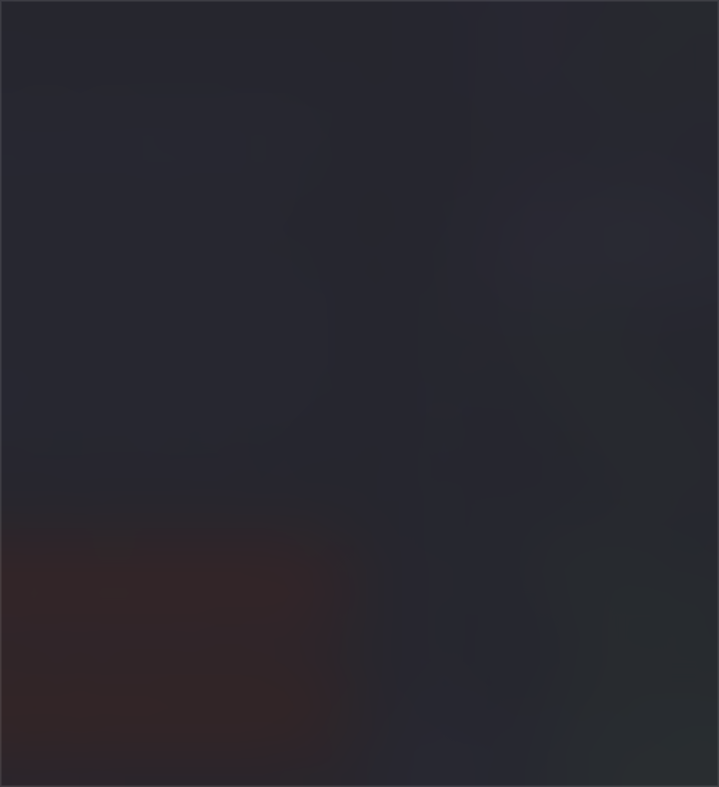
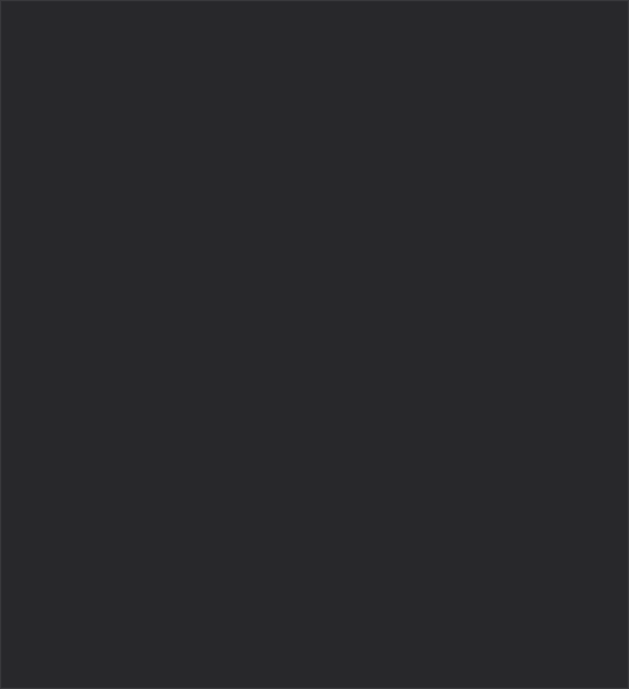

# Native editor fidelity gate

Date: 2026-10-17. **Gate not passed; Tasks 2–13 have not started.**

This is a disposable native feasibility harness, not the application or a production release. The initial design required editable title/link accents together with native editing. The supported Slint input path did not meet that inline-style requirement. The user has now selected revision A: supported plain-text Slint editing with inline heading/link colors deferred. Full themes remain required. Remaining native editing, materials, activation, and accessibility observations are still incomplete.

## Environment

- macOS 27.0.1, build 26A434; arm64 host.
- Rust 1.99.1 (`58cf8f9c3`, 2026-10-13) is pinned and installed. **Correction:** the original captures and checks ran on Rust/Cargo 1.98.0 because this agent session sets `RUSTUP_TOOLCHAIN=1.98.0`, overriding the file. New checks explicitly use `rustup run 1.99.1 cargo`; results below identify the actual compiler.
- Slint and slint-build 1.18.1; exact direct dependencies and resolved Cargo.lock.
- Winit backend, explicitly selected FemtoVG/OpenGL and Skia renderers.
- Deployment target 14.0 is configured; macOS 14/15 and Intel execution are untested.
- Preferred content size 505×552, minimum constraints 400×440 logical pixels. Minimum-size interaction has not been tested.

## Results

| Requirement | Evidence | Result |
| --- | --- | --- |
| Native build/window | Both explicitly selected renderers open the same compiled `.slint` window; public AppKit handle available after event-loop startup | Passed smoke check |
| Source-byte set/get roundtrip | Child native process receives frontmatter, CRLF, tab, café, 👩🏽‍💻, and 日本語 through stdin; editor-bound source is returned through stdout after event-loop startup; bytes compare exactly | Passed, set/get only |
| Styled display text | Separate StyledText renders bold text and a colored link | Passed display demonstration; not editable |
| Editable per-range title/link accents | TextInput rejects styled-text and has no text-format property; plain editor in captured native window has uniform text color | Initial target failed; user-approved revision A defers this feature |
| Real IME composition, undo/redo, clipboard, selection, wrapped caret/scroll | No interactive native editing observation recorded | Unobserved |
| Native material behind opaque glyphs | No material adapter implemented or tested | Unobserved |
| Global shortcut, pinning, full-screen activation/previous-app focus | Not exercised | Unobserved |
| VoiceOver, reduced transparency/motion | Not exercised | Unobserved |

The native acceptance test intentionally fails while required observations remain unverified. Its report never promotes a successful window creation to evidence of editing, accessibility, or platform behavior. The byte test cannot establish what happens during a real edit.

## Concrete API boundary

These commands exit 101 with Slint 1.18.1:

```sh
BULLETNOTES_SLINT_PROBE=styled-input cargo check --features native-validation --locked
# Cannot convert styled-text to string

BULLETNOTES_SLINT_PROBE=text-format cargo check --features native-validation --locked
# Unknown property text-format in TextInput
```

The disposable probe sources are `ui/probes/styled-input.slint` and `ui/probes/text-format.slint`. Build.rs only runs one when both the development feature and its explicit environment selector are supplied. Normal builds exclude these intentionally rejected experiments.

The official TextInput declaration has one text brush and a string value. StyledText accepts a separate styled-text value and provides display/link behavior. They do not form a styled editor by substituting one value type for the other. This is an input contract issue, independent of the renderer.

A transparent-input/display-overlay experiment would need identical layout, hit testing, caret/selection geometry and IME preedit rendering. In the pinned official compiler declaration, cursor/anchor byte offsets are explicitly marked “Internal, undocumented … only exposed for tests”; preedit text is marked internal/undocumented for IME. This harness does not rely on those internals or claim an overlay meets the approved input contract. No custom renderer, private Slint API, webview, or AppKit editor was introduced.

This evidence establishes a limitation of the supported direct input approach, not a mathematical impossibility of every possible editor implementation. An alternative needs its own design and native validation.

## Native captures

Both images capture only the test app's window. They show the editable source above and a separate styled display below. They are feasibility screenshots, not a finished UI matching the approved mockup.


The first discarded capture exposed white system-dark widget text on Paper. The harness now selects the public light palette explicitly for a deterministic comparison. Application theme support remains Task 3/5 work.

## Reproduce

```sh
cargo build --example native_gate --example native_window_probe --locked
cargo test --test native_gate text_input_roundtrips_unicode_and_crlf --locked -- --ignored --nocapture
# Expected: 1 passed. Opens and closes a native child window.

cargo test --test native_gate --locked -- --ignored --nocapture
# Expected at this stage: 1 passed, 1 failed; fidelity remains unmet.

SLINT_BACKEND=winit-femtovg cargo run --example native_window_probe --locked -- --auto-close
SLINT_BACKEND=winit-skia cargo run --features probe-skia --example native_window_probe --locked -- --auto-close
# Both open a native comparison window for 15 seconds and print observations.

cargo fmt --check
cargo check --all-targets --locked
```

Public raw handles may be unavailable until the native event loop has started; inspection runs from a main-thread Slint timer after startup. AppKit is used only to inspect the borrowed NSView/window and OS version. No ownership transfer or mutation occurs across that boundary.

## Checkpoint verification

- `cargo fmt --check`: passed.
- `cargo check --all-targets --locked`: passed.
- `cargo clippy --all-targets --all-features --locked -- -D warnings`: passed.
- `git diff --check`: passed.
- Final explicitly FemtoVG native test run: **1 passed, 1 failed**, as detailed above. This is not a green acceptance suite.
- No note contents were fetched and no server writes were attempted during this implementation checkpoint.

## Decision recorded: A selected

The initial native gate stopped for the unsupported inline-style requirement. The user subsequently selected A explicitly. This is an approved scope revision; it does not establish the remaining native behavior as passing.

The alternatives presented were:

1. Keep the Slint plain Markdown editor, full app themes, and accented interface controls; defer inline title/link accents. This preserves the chosen Rust/Slint architecture with the smallest scope change. Remaining native input/material/lifecycle checks still apply.
2. Retain editable inline accents as a requirement and authorize investigation of an AppKit NSTextView adapter. Slint would continue to own the surrounding interface; editor integration would become a new platform boundary and require a revised plan and validation. This has not been proven here.

Revision A is approved; alternative 2 is not. Native feasibility remains incomplete pending the other observations. Frameless window feasibility is being checked separately in response to the user’s next question.

## Official references

- [TextInput public input contract](https://docs.slint.dev/latest/docs/slint/reference/keyboard-input/textinput/).
- [Slint 1.18.1 compiler element declarations](https://github.com/slint-ui/slint/blob/v1.18.1/internal/compiler/builtin_elements.rs): TextInput value/color and internal offset/preedit annotations.
- [Slint 1.18.1 text implementation](https://github.com/slint-ui/slint/blob/v1.18.1/internal/core/items/text.rs): separate input and styled display types.
- [Slint 1.18.1 styled-text API](https://github.com/slint-ui/slint/blob/v1.18.1/internal/core/styled_text.rs).

## Frameless-window investigation

The user asked whether an Antinote-style “windowless” experience is possible. A disposable `--frameless` variant now uses Slint's documented `no-frame`, `resize-border-width`, and `WindowMoveArea`. The ordinary harness remains framed unless the example receives this flag.

On macOS 27.0.1 / arm64 with explicitly selected winit-femtovg, the variant opened and exited normally. Public AppKit inspection returned:

```text
has_native_titlebar: false
can_become_key_window: true
```

This confirms native frameless creation and AppKit's keyboard-focus eligibility. It does not establish actual typing, IME, drag/resize gestures, focus restoration, or full-screen behavior. The current capture is square; rounded corners, shadows, background materials, and final controls remain to be designed/validated. This is a throwaway feasibility variant, not final application chrome.


```sh
SLINT_BACKEND=winit-femtovg cargo run --example native_window_probe --locked -- --frameless --auto-close
```

Slint documents [frameless windows and resize borders](https://docs.slint.dev/latest/docs/slint/reference/window/window/) and [WindowMoveArea on winit/macOS](https://docs.slint.dev/latest/docs/slint/reference/window/windowmovearea/). A separate [SystemTrayIcon](https://docs.slint.dev/latest/docs/slint/reference/window/systemtrayicon/) can provide the macOS menu-bar entry. Apple's [accessory activation policy](https://developer.apple.com/documentation/appkit/nsapplication/activationpolicy-swift.enum/accessory) supports an app absent from the Dock while retaining programmatic/window activation; this policy has not been exercised by the probe. It is distinct from removing visible window chrome. Native [NSVisualEffectView](https://developer.apple.com/documentation/appkit/nsvisualeffectview) is the candidate background-material API, still unverified with the chosen renderer.

The question about keeping Dock access versus menu-bar-only mode is pending. No final lifecycle policy has been selected on the user's behalf.

## Material-composition investigation (in progress)

The `native-validation` feature now exposes a disposable `--material` window with a transparent Slint root, alpha-tinted paper, and opaque TextInput ink. A public NSVisualEffectView is added below the existing native view's subviews. Winit's contentView identity is preserved. Replacing contentView in the initial experiment caused a native abort on focus loss because Winit assumes its own content-view class; that approach was rejected. The retained effect view is removed on teardown, and prior window background/opacity are restored.

A native child-process test initially failed because the adapter did not exist. On Rust 1.98.0, the corrected adapter passed the renderer-pixel check: native effect attached, whole-window alpha 1.0, more than 100 translucent-paper pixels and more than 100 fully opaque ink pixels. This establishes the Slint render-buffer alpha boundary, not the complete visual effect or accessibility/lifecycle correctness. The pinned 1.99.1 rebuild succeeded. The render-buffer check also passed there, but the stronger native-composite check failed on both renderers: the effect view covers the note. This is a failed composition candidate, not a successful native-material implementation.

Reference pattern: [upstream window-vibrancy native implementation](https://github.com/tauri-apps/window-vibrancy/blob/dev/src/macos/vibrancy.rs). No additional vibrancy library, private AppKit API, or renderer fork was introduced.

### Native composite outcome: failed on both tested renderers

Commands actually run with Rust/Cargo 1.99.1:

```sh
rustup run 1.99.1 cargo build --features native-validation,probe-skia --example native_window_probe --locked
SLINT_BACKEND=winit-femtovg rustup run 1.99.1 cargo test --features native-validation --test native_gate native_material_keeps_ink_opaque_over_translucent_paper --locked -- --ignored --nocapture
SLINT_BACKEND=winit-skia rustup run 1.99.1 cargo test --features native-validation,probe-skia --test native_gate native_material_keeps_ink_opaque_over_translucent_paper --locked -- --ignored --nocapture
```

Both strengthened native tests failed with `native material obscures paper: 0 light pixels`. The test captures only the app window and requires both paper and glyph pixels in its interior; a successful offscreen alpha readback alone cannot pass it. Temporary screenshots are isolated through tempfile; png 0.18.1 decodes the actual captured pixels. These are test-only dependencies. The existing tempfile pin was introduced earlier than Task 4 for this native acceptance check.

A separate diagnostic disabled Slint render-buffer readback and waited two additional seconds before capturing the exact on-screen window rectangle. A temporary public-CoreGraphics helper checked the window ID against the child PID and returned only its bounds. These captures also show the effect covering the editor. This rules out the tested readback path, first-frame delay, and window-only screenshot behavior as explanations for the failed candidate. The helper lives in `/tmp`; no private API or new production bridge was introduced.

| Approach | Outcome |
| --- | --- |
| Replace native contentView with an effect container | Rejected: Winit assumes its own contentView class and aborts on focus loss |
| Preserve contentView; add effect below its subviews, FemtoVG | Effect appears, note is covered |
| Same hierarchy with stable Skia | Effect appears, note is covered |





This does not prove that every public native-hosting arrangement is impossible. It establishes that these tested approaches do not satisfy the approved gate. The adapter remains in an explicitly selected disposable example behind `native-validation`; the normal framed/frameless solid harness is unaffected. No native-material technique has been selected for production.

### Next decision

The user-approved A revision deferred inline heading/link colors only. Native blur remains a requirement. Task 1 therefore remains incomplete and downstream tasks have not begun.

- Recommended smaller revision: retain Rust/Slint, frameless notes and full themes; use solid paper for the first release and defer native blur.
- If native blur is essential now: review a revised macOS window-hosting design and its validation before continuing. No private view hierarchy, custom renderer, or backend fork is presumed approved.

After that decision, finish the remaining native input/lifecycle observations, then proceed to page models, theme support, durable local notes, and guarded automatic sync in the existing plan. Actual IME and VoiceOver checks cannot be represented by synthetic key events or policy-unit tests.

### Checkpoint verification with the pinned compiler

`rustup run 1.99.1 cargo fmt --check` and `rustup run 1.99.1 cargo clippy --all-targets --all-features --locked -- -D warnings` passed. The standard all-feature lib/bin/test/example suite passed 3 policy tests and skipped 3 explicitly ignored native tests. The separately executed compositor regression failed as described above; the overall native gate is not green. The Unicode/CRLF child-process roundtrip was rebuilt and rerun with Rust 1.99.1 rather than relying on the earlier 1.98.0 result.

## Decision recorded: native blur deferred (revision B)

The user approved solid themed paper for the first release after reviewing the material failure. Native blur is no longer a first-release acceptance requirement; its ignored experimental regression remains as failure evidence for future work. Full themes, frameless UI, input correctness, accessibility and activation/focus requirements remain. Do not present an experimental material probe as production functionality.


## Interactive solid-paper checkpoint

With approved revisions A and B, the native preview uses opaque themed paper, a frameless draggable/resizable window, Pin/Unpin, and a temporary text editor. A public-AppKit native level test observed the level rise when pinned and return to its prior value after unpinning (1/1 passed). A three-second interactive smoke run registered Option+A and exited successfully, releasing the shortcut. The preview has a “BN test” menu for reopening and quitting.

The development bundle was ad-hoc signed and verified, then opened for manual observations. It is not a notarized production artifact. Its temporary text is neither persisted nor sent to SilverBullet. Typing/undo/selection, real IME composition, VoiceOver, caret/focus restoration, and full-screen activation remain pending human observations; the native gate is still incomplete. Instructions: [native-checklist.md](native-checklist.md).

Verification on explicit Rust 1.99.1: standard all-feature library/binary/test/example suite passed (4 policy tests; 4 native tests ignored), formatting and diff checks passed, and all-target/all-feature Clippy passed. After the UI change, the native Unicode/CRLF source-byte roundtrip was rerun and passed (1/1). The deferred material regression and incomplete aggregate remain explicitly excluded from a success claim.


## Preview 2: resize failure and hover bar

The user's real-desktop check reported resizing failing and the drag area too small. Those are observed failures in Preview 1; other manual rows remain untested. The requested behavior is a full-width top strip whose bar appears on hover.

Root cause: Slint 1.18.1's resize-border-width path calls winit's drag_resize_window and ignores its error. The macOS implementation in pinned winit 0.30.13 returns NotSupported. A resizable style bit alone was insufficient. See [winit's platform limitation](https://docs.rs/winit/0.30.13/winit/window/struct.Window.html#method.drag_resize_window).

Preview 2 instead uses public AppKit window configuration: Titled + Resizable + FullSizeContentView, hidden title text, and transparent titlebar. This provides the native frame while retaining the frameless appearance. Slint's content view and ownership remain intact. A local application event monitor reveals the full-width 36-pixel bar and standard window buttons near the top; it returns incoming events unchanged and is removed on teardown. It does not install a global mouse monitor. Window movement remains through WindowMoveArea / AppKit. Native blur stays deferred.

Evidence on explicit Rust 1.99.1 / macOS 27.0.1 arm64: resize configuration regression RED then GREEN, policy tests RED (4 pass / 2 fail) then GREEN (6 pass), native pin/unpin test GREEN with the new frame, interactive startup/shutdown exit 0. Hover regression GREEN after identifying two test-fixture issues: delayed snapshots raced real mouse movement, and AppKit exposed only the low 16 bits of synthetic mouse event numbers. The corrected test observes identifiable owned-window events at delivery, verifies reveal→hide and exact text preservation, and exits on completion. Synthetic hover is not proof of physical resize gestures, IME, or VoiceOver.

The standard all-feature suite passed 46 tests with 7 ignored (six native cases plus the child-only storage fixture), default all-target check and all-target/all-feature Clippy passed, and formatting/diff checks passed. The separate Preview 2 development .app was ad-hoc signed, verified, opened, and a targeted human resize/hover retry requested. No physical-gesture success or native-gate completion is inferred from configuration alone.
