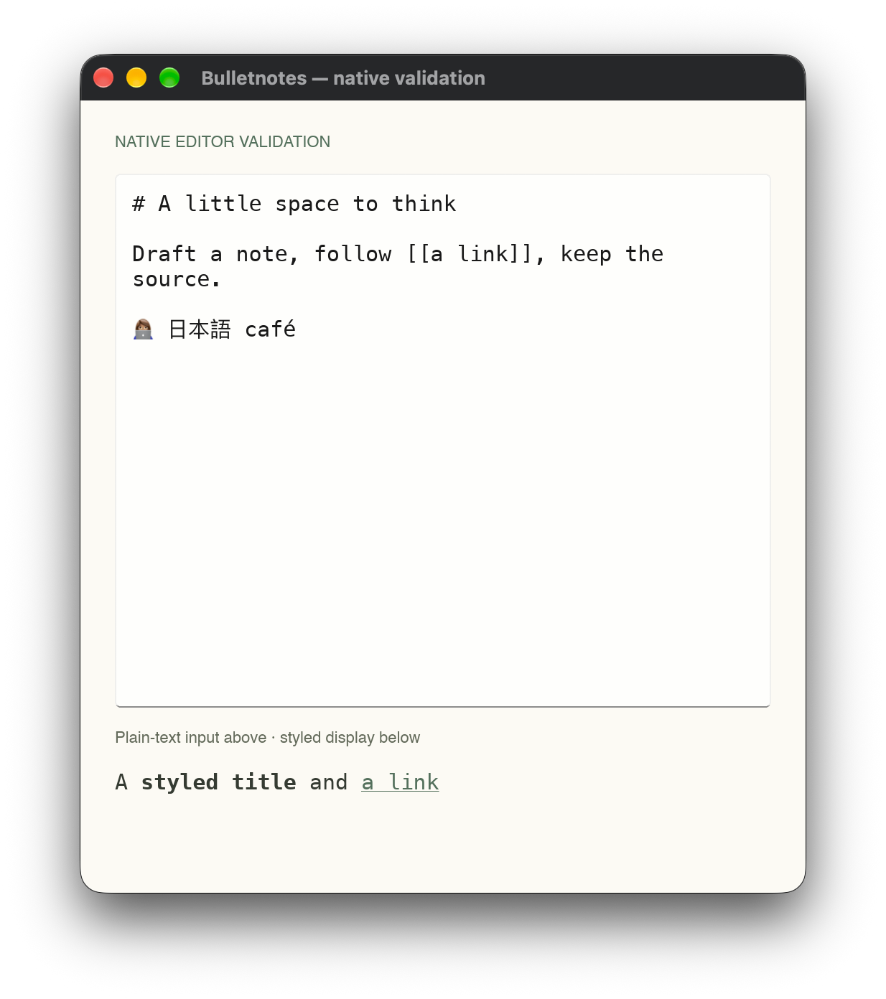
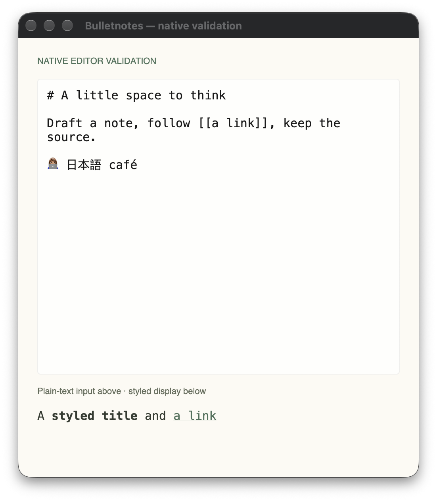
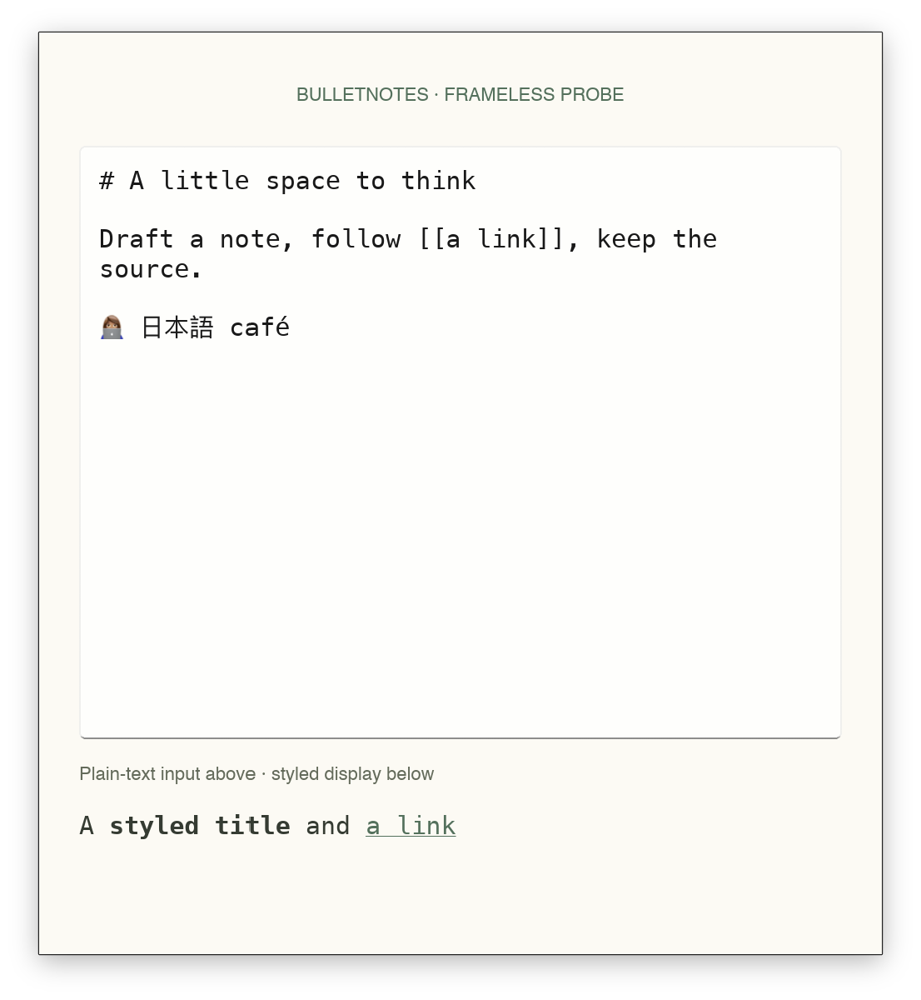

# Native editor fidelity gate

Date: 2026-10-17. **Gate not passed; Tasks 2–13 have not started.**

This is a disposable native feasibility harness, not the application or a production release. The initial design required editable title/link accents together with native editing. The supported Slint input path did not meet that inline-style requirement. The user has now selected revision A: supported plain-text Slint editing with inline heading/link colors deferred. Full themes remain required. Remaining native editing, materials, activation, and accessibility observations are still incomplete.

## Environment

- macOS 27.0.1, build 26A434; arm64 host.
- Rust 1.99.1 (`58cf8f9c3`, 2026-10-13), edition 2024; exact compiler pinned.
- Slint and slint-build 1.18.1; exact direct dependencies and resolved Cargo.lock.
- Winit backend, explicitly selected FemtoVG/OpenGL and Skia renderers.
- Deployment target 14.0 is configured; macOS 14/15 and Intel execution are untested.
- Preferred content size 505×552, minimum constraints 400×440 logical pixels. Minimum-size interaction has not been tested.

## Results

| Requirement | Evidence | Result |
| --- | --- | --- |
| Native build/window | Both explicitly selected renderers open the same compiled `.slint` window; public AppKit handle available after event-loop startup | Passed smoke check |
| Source-byte set/get roundtrip | Child native process receives frontmatter, CRLF, tab, café, 👩🏽‍💻, and 日本語 through stdin; editor-bound source is returned through stdout after event-loop startup; bytes compare exactly | Passed, set/get only |
| Styled display text | Separate StyledText renders bold text and a colored link | Passed display demonstration; not editable |
| Editable per-range title/link accents | TextInput rejects styled-text and has no text-format property; plain editor in captured native window has uniform text color | Initial target failed; user-approved revision A defers this feature |
| Real IME composition, undo/redo, clipboard, selection, wrapped caret/scroll | No interactive native editing observation recorded | Unobserved |
| Native material behind opaque glyphs | No material adapter implemented or tested | Unobserved |
| Global shortcut, pinning, full-screen activation/previous-app focus | Not exercised | Unobserved |
| VoiceOver, reduced transparency/motion | Not exercised | Unobserved |

The native acceptance test intentionally fails while required observations remain unverified. Its report never promotes a successful window creation to evidence of editing, accessibility, or platform behavior. The byte test cannot establish what happens during a real edit.

## Concrete API boundary

These commands exit 101 with Slint 1.18.1:

```sh
BULLETNOTES_SLINT_PROBE=styled-input cargo check --features native-validation --locked
# Cannot convert styled-text to string

BULLETNOTES_SLINT_PROBE=text-format cargo check --features native-validation --locked
# Unknown property text-format in TextInput
```

The disposable probe sources are `ui/probes/styled-input.slint` and `ui/probes/text-format.slint`. Build.rs only runs one when both the development feature and its explicit environment selector are supplied. Normal builds exclude these intentionally rejected experiments.

The official TextInput declaration has one text brush and a string value. StyledText accepts a separate styled-text value and provides display/link behavior. They do not form a styled editor by substituting one value type for the other. This is an input contract issue, independent of the renderer.

A transparent-input/display-overlay experiment would need identical layout, hit testing, caret/selection geometry and IME preedit rendering. In the pinned official compiler declaration, cursor/anchor byte offsets are explicitly marked “Internal, undocumented … only exposed for tests”; preedit text is marked internal/undocumented for IME. This harness does not rely on those internals or claim an overlay meets the approved input contract. No custom renderer, private Slint API, webview, or AppKit editor was introduced.

This evidence establishes a limitation of the supported direct input approach, not a mathematical impossibility of every possible editor implementation. An alternative needs its own design and native validation.

## Native captures

Both images capture only the test app's window. They show the editable source above and a separate styled display below. They are feasibility screenshots, not a finished UI matching the approved mockup.





The first discarded capture exposed white system-dark widget text on Paper. The harness now selects the public light palette explicitly for a deterministic comparison. Application theme support remains Task 3/5 work.

## Reproduce

```sh
cargo build --example native_gate --example native_window_probe --locked
cargo test --test native_gate text_input_roundtrips_unicode_and_crlf --locked -- --ignored --nocapture
# Expected: 1 passed. Opens and closes a native child window.

cargo test --test native_gate --locked -- --ignored --nocapture
# Expected at this stage: 1 passed, 1 failed; fidelity remains unmet.

SLINT_BACKEND=winit-femtovg cargo run --example native_window_probe --locked -- --auto-close
SLINT_BACKEND=winit-skia cargo run --features probe-skia --example native_window_probe --locked -- --auto-close
# Both open a native comparison window for 15 seconds and print observations.

cargo fmt --check
cargo check --all-targets --locked
```

Public raw handles may be unavailable until the native event loop has started; inspection runs from a main-thread Slint timer after startup. AppKit is used only to inspect the borrowed NSView/window and OS version. No ownership transfer or mutation occurs across that boundary.

## Checkpoint verification

- `cargo fmt --check`: passed.
- `cargo check --all-targets --locked`: passed.
- `cargo clippy --all-targets --all-features --locked -- -D warnings`: passed.
- `git diff --check`: passed.
- Final explicitly FemtoVG native test run: **1 passed, 1 failed**, as detailed above. This is not a green acceptance suite.
- No note contents were fetched and no server writes were attempted during this implementation checkpoint.

## Decision recorded: A selected

The initial native gate stopped for the unsupported inline-style requirement. The user subsequently selected A explicitly. This is an approved scope revision; it does not establish the remaining native behavior as passing.

The alternatives presented were:

1. Keep the Slint plain Markdown editor, full app themes, and accented interface controls; defer inline title/link accents. This preserves the chosen Rust/Slint architecture with the smallest scope change. Remaining native input/material/lifecycle checks still apply.
2. Retain editable inline accents as a requirement and authorize investigation of an AppKit NSTextView adapter. Slint would continue to own the surrounding interface; editor integration would become a new platform boundary and require a revised plan and validation. This has not been proven here.

Revision A is approved; alternative 2 is not. Native feasibility remains incomplete pending the other observations. Frameless window feasibility is being checked separately in response to the user’s next question.

## Official references

- [TextInput public input contract](https://docs.slint.dev/latest/docs/slint/reference/keyboard-input/textinput/).
- [Slint 1.18.1 compiler element declarations](https://github.com/slint-ui/slint/blob/v1.18.1/internal/compiler/builtin_elements.rs): TextInput value/color and internal offset/preedit annotations.
- [Slint 1.18.1 text implementation](https://github.com/slint-ui/slint/blob/v1.18.1/internal/core/items/text.rs): separate input and styled display types.
- [Slint 1.18.1 styled-text API](https://github.com/slint-ui/slint/blob/v1.18.1/internal/core/styled_text.rs).

## Frameless-window investigation

The user asked whether an Antinote-style “windowless” experience is possible. A disposable `--frameless` variant now uses Slint's documented `no-frame`, `resize-border-width`, and `WindowMoveArea`. The ordinary harness remains framed unless the example receives this flag.

On macOS 27.0.1 / arm64 with explicitly selected winit-femtovg, the variant opened and exited normally. Public AppKit inspection returned:

```text
has_native_titlebar: false
can_become_key_window: true
```

This confirms native frameless creation and AppKit's keyboard-focus eligibility. It does not establish actual typing, IME, drag/resize gestures, focus restoration, or full-screen behavior. The current capture is square; rounded corners, shadows, background materials, and final controls remain to be designed/validated. This is a throwaway feasibility variant, not final application chrome.



```sh
SLINT_BACKEND=winit-femtovg cargo run --example native_window_probe --locked -- --frameless --auto-close
```

Slint documents [frameless windows and resize borders](https://docs.slint.dev/latest/docs/slint/reference/window/window/) and [WindowMoveArea on winit/macOS](https://docs.slint.dev/latest/docs/slint/reference/window/windowmovearea/). A separate [SystemTrayIcon](https://docs.slint.dev/latest/docs/slint/reference/window/systemtrayicon/) can provide the macOS menu-bar entry. Apple's [accessory activation policy](https://developer.apple.com/documentation/appkit/nsapplication/activationpolicy-swift.enum/accessory) supports an app absent from the Dock while retaining programmatic/window activation; this policy has not been exercised by the probe. It is distinct from removing visible window chrome. Native [NSVisualEffectView](https://developer.apple.com/documentation/appkit/nsvisualeffectview) is the candidate background-material API, still unverified with the chosen renderer.

The question about keeping Dock access versus menu-bar-only mode is pending. No final lifecycle policy has been selected on the user's behalf.
